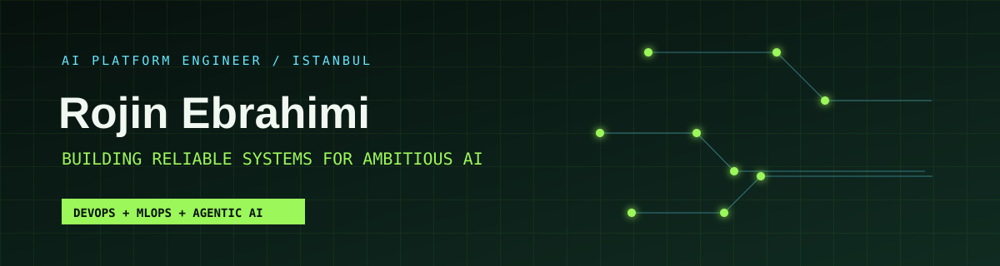
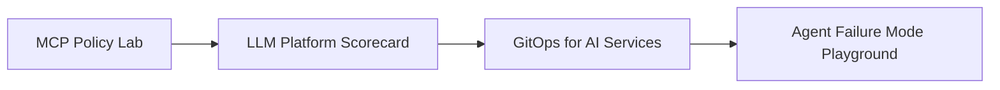

<p align="center">
  <a href="https://www.linkedin.com/in/rojinebrahimi"></a>
  <a href="https://rojin.dev"></a>
  <a href="https://t.me/rojinebrahimi"></a>
</p>

<p align="center"><strong>AI Platform Engineer · DevOps &amp; MLOps</strong></p>

> I build the paved roads between ambitious AI ideas and production-ready systems.

```text
╭─ system.identity ─────────────────────────────────────────────╮
│  name      Rojin Ebrahimi                                     │
│  focus     LLM gateways · agentic workflows · cloud native    │
│  principle secure + observable + repeatable by default        │
╰───────────────────────────────────────────────────────────────╯
```

I work where **AI infrastructure** meets **developer experience**: creating gateways, orchestration, and platform foundations that help teams use LLMs safely and productively at scale. My DevOps background means I care as much about reliability, latency, and operability as I do about what a model can do.

| `NOW` | `IMPACT` | `OPEN TO` |
| :-- | :-- | :-- |
| AI Platform Engineer @ Snapp | Secure agentic delivery paths for **1,000+ developers** | AI Platform Engineering · MLOps · DevOps |

## `01 / platform_mission`

<table>
  <tr>
    <td width="33%"><strong>▣ AI Gateway Architecture</strong><br/><sub>Designing internal LLM access that is reliable, governed, and secure.</sub></td>
    <td width="33%"><strong>◇ Agentic Workflows</strong><br/><sub>Integrating custom AI agents and MCP servers for safe, useful tool calling.</sub></td>
    <td width="33%"><strong>◉ Developer Enablement</strong><br/><sub>Standardizing the paths that help teams ship AI without operational debt.</sub></td>
  </tr>
</table>

## `02 / engineering_stack`

<details open>
<summary><strong>AI Platform &amp; MLOps</strong></summary>
<br/>

`MLflow` `Evidently AI` `LLM Gateways` `MCP` `Agentic Tooling` `AI Orchestration` `Custom AI Agents`
</details>

<details>
<summary><strong>Cloud-Native &amp; Delivery</strong></summary>
<br/>

`Kubernetes` `RKE2` `Docker` `Helm` `Terraform` `Ansible` `Argo CD` `GitLab CI/CD` `GitHub Actions` `Python` `Go` `Linux` `Shell`
</details>

<details>
<summary><strong>Reliability, Security &amp; Data</strong></summary>
<br/>

`Prometheus` `Grafana` `Zabbix` `ELK Stack` `Sentry` `Kafka` `RabbitMQ` `Redis` `ClickHouse` `Vault` `Consul`
</details>

## `03 / open_source_signals`

| Repository | Signal |
| --- | --- |
| [**ansible-playbooks**](https://github.com/rojinebrahimi/ansible-playbooks) | Reusable automation for installation and configuration work. |
| [**python-automation**](https://github.com/rojinebrahimi/python-automation) | Practical utilities that remove repeatable work from everyday workflows. |
| [**portfolio**](https://github.com/rojinebrahimi/portfolio) | A Go portfolio that documents my technical direction in public. |

## `04 / experiment_queue`

The projects I’m most excited to build in the open:



- **MCP Policy Lab** — a reference platform for permissions, audit trails, and safe tool-calling boundaries.
- **LLM Platform Scorecard** — an opinionated dashboard for gateway health, cost, latency, quality, and model usage.
- **GitOps for AI Services** — production-minded templates for models, agents, evaluations, and observability.
- **Agent Failure Mode Playground** — reproducible failure scenarios with practical reliability patterns.

## `05 / beyond_the_terminal`

I’m the founder and host of [**Enguru**](https://podcasts.apple.com/us/podcast/enguru/id1810482609), a bite-sized English-learning podcast for clearer, more confident communication. Away from a terminal, I figure skate, practise yoga, paint, and play guitar. I’m also improving my German—currently **B2**.

<p align="center">
  <a href="mailto:therojinebrahimi@gmail.com"><strong>Start a conversation ↗</strong></a>
</p>
