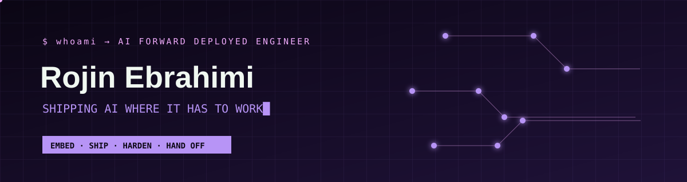
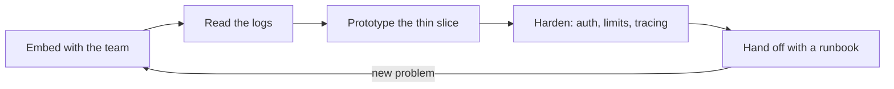

<p align="center">
  <a href="https://www.linkedin.com/in/rojinebrahimi"></a>
  <a href="https://rojin.dev"></a>
  <a href="https://t.me/rojinebrahimi"></a>
</p>

<p align="center"><strong>AI Forward Deployed Engineer · LLM systems that survive contact with production</strong></p>

> I'm the engineer who shows up where the demo ends and the pager begins.

```yaml
# fde.yaml: what you get when you deploy me
apiVersion: rojin.dev/v1
kind: ForwardDeployedEngineer
metadata:
  name: rojin-ebrahimi
  labels: { stack: go-python-k8s, mode: embedded-with-your-team }
spec:
  mission: close the gap between "works in the notebook" and "works at 3 a.m."
  deploys:
    - LLM gateways with real guardrails
    - agentic workflows and MCP servers
    - observability before the first user arrives
  defaults: { secure: true, observable: true, repeatable: true }
  sideEffects: [fewer-incidents, happier-developers, smaller-token-bills]
```

I work where **AI infrastructure** meets **the people who have to use it**. As a forward deployed engineer I sit with the team, read their logs before I draw the architecture, and build the thing that actually fits: gateways, orchestration and platform foundations that let developers use LLMs safely at scale. My DevOps roots mean I care as much about latency, reliability and operability as I do about what a model can do.

| `NOW` | `IMPACT` | `OPEN TO` |
| :-- | :-- | :-- |
| AI Forward Deployed Engineer @ Snapp | Secure agentic delivery paths for **1,000+ developers** | Forward-deployed AI · AI Platform · MLOps |

## `01 / the_fde_loop`



**Rules of engagement**

1. Read the logs before the architecture diagram.
2. Make the safe path the easy path.
3. If it isn't observable, it isn't shipped.
4. Leave behind a runbook, not a dependency on me.

## `02 / what_i_deploy`

<table>
  <tr>
    <td width="33%"><strong>▣ AI Gateways</strong><br/><sub>Internal LLM access that is reliable, governed and secure.</sub></td>
    <td width="33%"><strong>◇ Agentic Workflows</strong><br/><sub>Custom agents and MCP servers with safe, useful tool calling.</sub></td>
    <td width="33%"><strong>◉ Developer Enablement</strong><br/><sub>Paved roads that let teams ship AI without operational debt.</sub></td>
  </tr>
</table>

## `03 / engineering_stack`

<details open>
<summary><strong>AI Platform &amp; MLOps</strong></summary>
<br/>

`MLflow` `Evidently AI` `LLM Gateways` `MCP` `Agentic Tooling` `AI Orchestration` `Custom AI Agents`
</details>

<details>
<summary><strong>Cloud-Native &amp; Delivery</strong></summary>
<br/>

`Kubernetes` `RKE2` `Docker` `Helm` `Terraform` `Ansible` `Argo CD` `GitLab CI/CD` `GitHub Actions` `Python` `Go` `Linux` `Shell`
</details>

<details>
<summary><strong>Reliability, Security &amp; Data</strong></summary>
<br/>

`Prometheus` `Grafana` `Zabbix` `ELK Stack` `Sentry` `Kafka` `RabbitMQ` `Redis` `ClickHouse` `Vault` `Consul`
</details>

## `04 / side_quests` (open source)

| Repository | Signal |
| --- | --- |
| [**budgeteer**](https://github.com/rojinebrahimi/budgeteer) | A Go CLI and Claude Code plugin that reads your Claude Code and Codex logs and suggests the best moves to cut your AI spend. |
| [**ansible-playbooks**](https://github.com/rojinebrahimi/ansible-playbooks) | Reusable automation for installation and configuration work. |
| [**python-automation**](https://github.com/rojinebrahimi/python-automation) | Practical utilities that remove repeatable work from everyday workflows. |
| [**portfolio**](https://github.com/rojinebrahimi/portfolio) | A Go portfolio that documents my technical direction in public. |

## `05 / experiment_queue`

What I'm most excited to build in the open next:

- **MCP Policy Lab**: a reference platform for permissions, audit trails and safe tool-calling boundaries.
- **LLM Platform Scorecard**: an opinionated dashboard for gateway health, cost, latency, quality and model usage.
- **GitOps for AI Services**: production-minded templates for models, agents, evaluations and observability.
- **Agent Failure Mode Playground**: reproducible failure scenarios with practical reliability patterns.

## `06 / beyond_the_terminal`

I'm the founder and host of [**Enguru**](https://podcasts.apple.com/us/podcast/enguru/id1810482609), a bite-sized English-learning podcast for clearer, more confident communication. Away from a terminal, I figure skate, practise yoga, paint and play guitar. I'm also improving my German, currently **B2**.

```text
$ echo "Got an AI system that needs to survive production?"
```

<p align="center">
  <a href="mailto:therojinebrahimi@gmail.com"><strong>Start a conversation ↗</strong></a>
</p>
